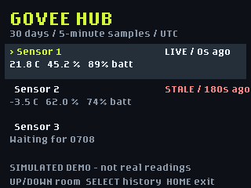

# Govee Hub

Govee Hub displays live H5075 temperature and humidity with thirty days of locally collected history.

## What it does

The Universe 2026 badge scans Govee H5075 Bluetooth broadcasts directly;
there is no bridge or Govee account. Choose your three thermometers once.
The main screen shows Celsius temperature, relative humidity, battery level,
and the age of each reading. Readings older than 60 seconds are marked STALE,
not presented as current. Invalid sensor readings are marked explicitly.

The badge records at most one fresh, valid reading per thermometer in each
five-minute UTC window. It retains a rolling thirty-day view and removes
expired daily files. It records **only while this app is open and within
Bluetooth range**. Missed periods stay blank; it does not retrieve earlier
records from the thermometer or Govee Home.

## First use, in plain English

1. Try the app in the Badge Simulator. The simulator does not receive your
   real thermometers or synchronize real time. Any demonstration readings
   injected during development are fictional and exist only in the simulator.
2. For hardware installation, connect the badge using a USB-C cable that
   carries data and press the simulator's **Deploy** button. Deployment uses
   USB Disk Mode, never serial writes to the read-only `/system` partition.
   See the [USB guide](../../../hardware/USB_SERIAL.md). Do not overwrite an
   existing app without a backup.
3. On the badge, enter your Wi-Fi network and password privately in the
   **Settings** app if they are not already configured. Do not paste them into
   chat or this repository. Govee Hub uses the firmware's existing `wifi`
   helper and `ntptime` to set UTC time; Wi-Fi is for the clock, not sensor
   readings. The network must allow DNS and NTP (UDP port 123).
4. Open **Govee Hub**. Wait for `UTC synced; 5min logs`. Each new app session
   must synchronize first: a reset badge clock is not trusted. If Wi-Fi/NTP
   fails, live readings still work, but recording waits and retries once per
   minute after a time-sync error. No timestamps or readings are invented.
5. Highlight Sensor 1 with UP/DOWN and press SELECT. Bring the desired
   thermometer close to the badge and close Govee Home so it is not connected.
   Use the displayed last four Bluetooth address digits and temperature to
   identify it; compare the Bluetooth address in Govee Home where available.
   Choose it with UP/DOWN, then SELECT. Pairing does not connect to or change
   the thermometer; it just saves its broadcast address.
6. Repeat for Sensor 2 and Sensor 3. A thermometer cannot occupy two slots,
   and existing slots cannot accidentally be replaced. Return each to its
   usual room and check that all three show fresh readings there.

Keep the badge powered, with this app open, to collect history continuously.
Use its normal USB power supply; obstacles and distance affect radio coverage.
The firmware shares its radio with Wi-Fi, so brief time synchronization can
interrupt scanning. No missed samples are filled in.
Govee Hub reserves a session with the current firmware's
`badgeware.radio.radio.open()` manager, then obtains its BLE object with
`ble()`. This prevents the firmware's idle service from powering down an
unmanaged scan. The session is closed on exit, including exception exits.
This API was verified on the connected firmware, not inferred from the
simulator or legacy badge.

## Controls

| Screen | Controls |
| --- | --- |
| Live overview | LEFT/RIGHT cycle display views; UP/DOWN select sensor; SELECT opens history or pairs an empty slot |
| Pairing | UP/DOWN choose; SELECT saves an empty slot; BACK cancels |
| History | LEFT/RIGHT select 24 hours, 7 days, or 30 days; SELECT switches temperature/humidity; BACK returns |
| Everywhere | HOME returns to the menu and releases Bluetooth/Wi-Fi |

### Display views

The home screen has five views. The top-right label shows which one is open,
for example `< Bars 2/5 >`. The selected view resets to List when the app is
reopened.

1. **List**: temperature, humidity, battery, and reading age for each sensor.
2. **Bars**: temperature and humidity bars for every sensor. All bars of each
   kind use the same scale: the lowest and highest current readings plus a
   margin, rounded to whole degrees or 5 % steps. The scale is shown under the
   title.
3. **Big numbers**: large Celsius temperatures, colored by temperature band,
   with humidity and battery below.
4. **Scenes**: one small animated scene per sensor, chosen by temperature:
   Freezing (below 0 °C, snowman), Chilly (0–16 °C, beanie and scarf),
   Comfy (16–24 °C, smiling in the sun), Warm (24–30 °C, sunglasses on the
   beach), and Scorching (30 °C and above, melting in the heat).
5. **24h temps**: saved temperature history for all three sensors on one
   chart covering the last 24 hours. Each sensor has its own color, matching
   the key at the top, and its number is shown at the end of its line. Points
   are averages of the saved five-minute records (about 16 minutes per point),
   on a shared scale labeled in °C. Times when nothing was recorded stay blank,
   so lines are never drawn across gaps. The chart needs Wi-Fi time, as other
   history does, and refreshes once a minute. It says so when there is no time
   yet or no saved readings. A storage read error shows a message and retries
   after a minute.

Stale readings (older than 60 seconds) are grey and marked STALE; scenes show
`?` for them rather than an out-of-date mood. Unpaired, waiting, and
invalid-reading sensors are labeled explicitly in every view.

History plots bucket averages in at most 80 screen columns, shows the actual
sample count and minimum/maximum, and leaves missing buckets blank. Times are
shown in **UTC**, not local daylight-saving time. Sensor labels are Sensor
1/2/3 in the order you choose them.

## Storage and recovery

Data is private to `/state/govee_hub/`, not the app directory or secrets file.
Each packed reading is ten bytes including a CRC-8 checksum. Three sensors at
five-minute intervals use about **253 KiB for thirty days**, up to about
262 KiB with the partially retained cutoff day, plus filesystem/config
overhead. This is a little larger than the initial eight-byte estimate because
records include battery status and corruption detection. The app leaves at
least 128 KiB free for other badge apps and refuses further writes if the
reserve would be crossed. `/state` is shared and only about 1 MiB total.

Closed/flushed daily files survive reopening. Startup checks logs and removes
an incomplete or corrupt tail with an explicit recovery warning. Configuration
and repaired-file replacement use a temporary file and a previous-copy backup
so an interrupted replacement can recover on reopening. Power loss can still
lose the most recent record; these are not transactional database guarantees.
On a storage error, recording pauses for the session while live display and
HOME remain usable. Free space deliberately if necessary, then reopen the app
to recover/retry. A clock earlier than saved history also pauses recording
until real time catches up.
Radio-scan failures instead show an explicit warning and retry after sixty
seconds; controls and the live/stale display remain usable. A per-operation
traceback file under this app's state folder preserves diagnostics without
letting a cleanup error overwrite the original scanner error.

No re-pair/delete control is included: this prevents accidental replacement of
your room histories. To replace a sensor, back up this app's entire state
folder first and review its configuration/history offline; do not edit or
delete other apps' state.

## Development checks and limitations



This preview uses **fictional simulator readings**, not measurements of your
home. Hardware verification and original-room coverage are separate checks.

```bash
python3 -m unittest discover -s tests -p test_govee_hub.py -v
python3 .github/skills/hyb26-skill/scripts/validate_app.py badge/apps/govee_hub --target both
python3 .github/scripts/validate_app_readmes.py badge/apps/govee_hub
```

Hardware BLE scan feasibility was verified on the current badge firmware with
two H5075 devices. This is not proof of all-three coverage in their rooms or
of thirty days of actual operation. NTP accuracy/drift depends on the network
and the badge's oscillator; a synchronized session uses monotonic elapsed
time to avoid later RTC changes and handles tick wrap while the app runs.
There is no claim of uninterrupted collection or sensor-history backfill.

Decoder reference:
[Bluetooth-Devices/govee-ble parser](https://github.com/Bluetooth-Devices/govee-ble/blob/main/src/govee_ble/parser.py).
H5075 readings require **active** scanning. Manufacturer ID `0xEC88` has a
six-byte payload; the three bytes at offsets 1-3 pack signed temperature
tenths and humidity tenths, and byte 4 contains battery/error bits.
